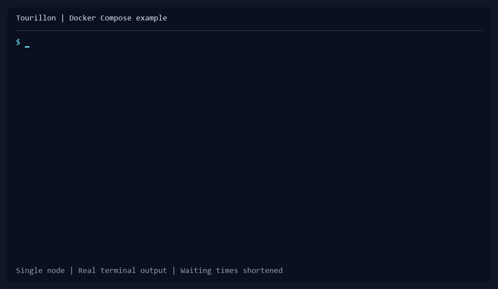

# Tourillon

**A distributed key-value store with no leader to elect and no central
controller to operate.**

Tourillon is an early-stage, leaderless database built for teams who want to
explore distributed storage without first adopting a large control plane. Run
database nodes as native applications, let them discover peers, and use the
same small command-line client to write, read, and delete values.

> **Development preview:** Tourillon is evolving quickly. It is not yet
> production-ready, and releases may introduce incompatible changes. Do not
> use it for critical or irreplaceable data.

[](examples/docker/README.md)

**Want to see it in action?** Try the
[Docker Compose example](examples/docker/README.md): start one node and use
the client to write, read, and delete a value. Docker handles the setup,
including certificates and configuration. This is a local example, not a
production deployment.

## Why try Tourillon?

- **No leader, no single controller.** Nodes share responsibility instead of
  relying on a central node to coordinate the cluster.
- **Data shared across nodes.** Nodes distribute and replicate key-value data
  across the cluster, coordinating directly with their peers.
- **A small operational surface.** `tourillon` runs and configures database
  nodes; `tourctl` lets you inspect nodes and work with key-value data.
- **Native, self-contained downloads.** Download the ZIP for your platform,
  extract it, and run the included offline installer.
- **mTLS between clients and nodes.** The setup commands generate the
  certificates and configuration needed to establish authenticated,
  encrypted connections.

Tourillon's longer-term product objectives—including multi-tenancy,
failure-domain-aware placement, and very large clusters—are described in
[Product objectives and principles](docs/PRINCIPLES.md). Those are design
goals, not a claim that every capability is available today.

## Choose how to try Tourillon

| Path | Choose it when you want to... |
| --- | --- |
| [Try with Docker](examples/docker/README.md) | Start a local node and client with certificates and configuration generated for you. |
| [Install natively](#install-natively) | Run the applications directly on Windows, Linux, or macOS, with no additional runtime to install. |

## Install natively

### Choose your download

Visit [GitHub Releases](https://github.com/mistersouls/tourillon/releases) and
download the ZIP matching your **product**, **operating system**, and
**processor architecture**. Each release contains separate downloads for:

| Product | Choose it when you want to… |
| --- | --- |
| `tourillon` | Run a database node. |
| `tourctl` | Manage or inspect nodes and read/write key-value data. |

Choose the `x86_64` build for most Intel/AMD computers and the `arm64` build
for ARM devices, including Apple Silicon Macs. The archive names include the
product, version, and platform, for example
`tourctl-0.1.0.dev1-windows-x86_64.zip`.

### Run the installer

1. Download the ZIP for each product you need. A server needs `tourillon`; a
   machine from which you administer the database needs `tourctl`.
2. Extract the complete ZIP to a folder.
3. Open a terminal in the extracted product folder—the folder containing
   `install.ps1` or `install.sh`—and run the installer:

**Windows — PowerShell:**

```powershell
.\install.ps1
```

**Linux and macOS:**

```sh
./install.sh
```

The installer sets up the product for your user and checks that the application
can start. On Windows, open a new terminal after installation so it
loads the updated `PATH`. On Linux and macOS, make sure `~/.local/bin` is on
your `PATH`; Linux bundles require glibc 2.35 or newer.

Confirm that the command is available:

```text
tourillon --help
tourctl --help
```

Each command is installed only if you installed its corresponding product.
For custom install locations, updating an existing installation, and platform
troubleshooting, see the [installation guide](scripts/bundle/README.md).

## Your first node and first value

The following walkthrough starts one node on the local machine, creates a
client identity, then writes and reads a value. It is a convenient way to try
Tourillon; it is not a production cluster configuration.

Create a working directory and generate a local certificate authority:

```sh
mkdir -p tourillon-demo
cd tourillon-demo
tourillon config ca ./certs
```

Generate the node configuration. `1Gi` is the storage allocation for a group;
adjust it to suit your machine:

```sh
tourillon config node node-1 ./data 1Gi \
  ./certs/ca-cert.pem ./certs/ca-key.pem \
  --output-file ./node.toml
```

Generate a client configuration for the node's local client and peer
endpoints, then start the node:

```sh
tourillon config client local-user \
  --ca-cert ./certs/ca-cert.pem \
  --ca-key ./certs/ca-key.pem \
  --output-file ./tourconf.toml \
  --client-address 127.0.0.1:7000 \
  --peer-address 127.0.0.1:7001

tourillon node start ./node.toml
```

Leave the node running. In a **second terminal** opened in the same
`tourillon-demo` directory, write and read a value:

```sh
tourctl put greeting "Hello, Tourillon!" --tourconf ./tourconf.toml
tourctl get greeting --tourconf ./tourconf.toml
```

Use `tourctl delete greeting --tourconf ./tourconf.toml` to delete it. The
default namespace is `default`; use `--namespace` to select another namespace.
For a remote or multi-node setup, use the command help and the
[architecture guide](docs/ARCHITECTURE.md) before exposing node endpoints.

**Protect the generated files.** The CA private key can issue trusted
certificates. Node and client configuration files contain private key material
as well. Do not publish them or share them as ordinary logs or support files.

## What is implemented—and what is not

The current preview includes peer membership, hash-based partitioning,
replicated key-value operations, configurable per-request read/write quorum
counts, node inspection, and certificate-based client/peer connections.
Quorums are numeric request options, not named consistency guarantees.

Some advertised distributed-database capabilities are still planned or
incomplete. In particular, namespaces currently label data but **do not
provide tenant isolation**; there are no namespace ACLs or quotas, and
placement does not yet enforce rack/zone/region anti-affinity. The 10,000-node
scale is an objective, not a benchmarked or supported deployment size.
Review the [architecture guide](docs/ARCHITECTURE.md) for implementation
details and the [backlog](docs/BACKLOG.md) for known gaps before evaluating
Tourillon for a real workload.

## Learn more

- [Product objectives and principles](docs/PRINCIPLES.md) — product vision and
  architectural direction.
- [Architecture](docs/ARCHITECTURE.md) — how nodes, clients, and storage work.
- [Installation guide](scripts/bundle/README.md) — platform options and
  troubleshooting.
- [Development guide](docs/DEVELOPMENT.md) — contributing, tests, and releases.

## License

Apache 2.0
